## 界面预览与功能说明

`batch-image-variants` 随包提供手机浏览器工具「叠影 · BATCH STUDIO」。以下截图按实际操作顺序展示：选择原图 → 设置参数 → 本地生成 → 查看结果 → 下载 ZIP。

以下为手机浏览器及其系统弹窗截图，不代表所有手机系统和浏览器均已完成兼容性认证。

### 01 · 主界面总览

首页整合原图选择、生成数量、日期时间、水印位置与输出尺寸设置，以及批量生成入口。页面说明图片在当前设备本地处理，不上传原图。

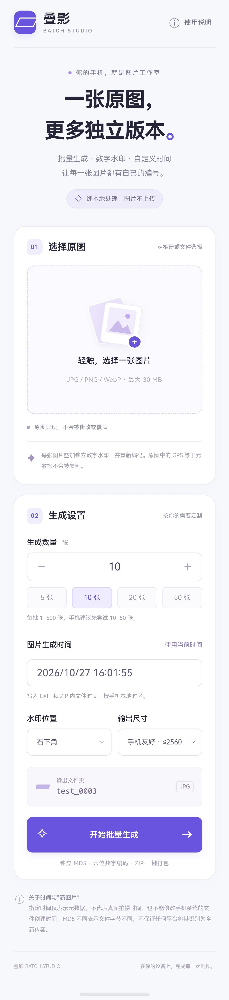

### 02 · 手机使用指南

使用说明弹窗介绍选图、设置参数、保持页面前台、下载 ZIP 和通过系统文件管理器解压的操作流程，并说明网页/PWA 与原生安装包的区别。

主屏幕入口、离线和系统分享等能力取决于浏览器与部署环境；正式部署请使用 HTTPS。

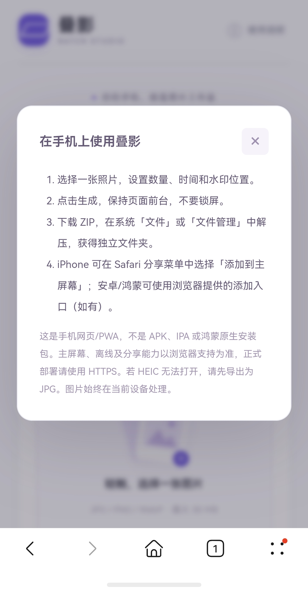

### 03 · 原图选择与预览

#### 选择图片来源

通过当前手机浏览器提供的系统选择面板，从图库、拍照或文件入口选取原图。这里展示的是系统面板，其他设备的入口和样式可能不同。

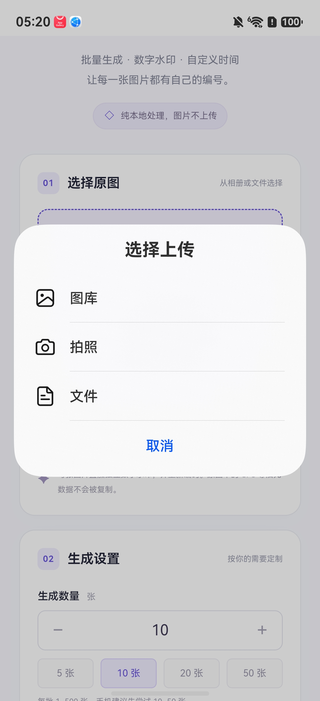

#### 查看原图与编号水印预览

选图后展示图片预览、原始文件名、分辨率和文件大小，并可更换图片。预览区域显示六位数字编号水印的示意位置，原图不会被修改或覆盖。

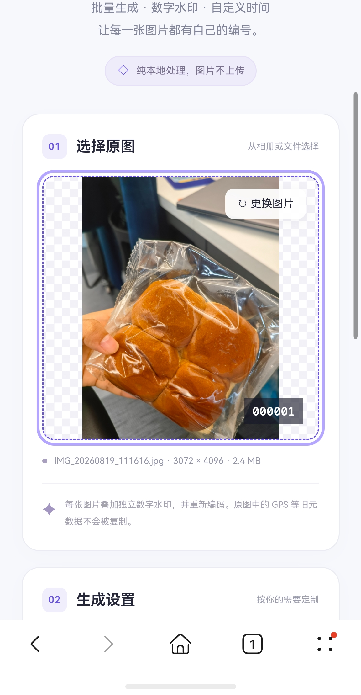

### 04 · 批量生成参数

#### 数量、日期与批次设置

通过加减按钮或快捷选项设置生成数量，每批支持 1–500 张；手机端建议先从 10–50 张尝试。日期时间可手动指定或使用当前时间，界面同时显示水印位置、输出尺寸和本批输出文件夹。

指定时间用于 EXIF 元数据及 ZIP 内文件时间，不代表真实拍摄时间，也不能任意修改手机系统的文件创建时间。

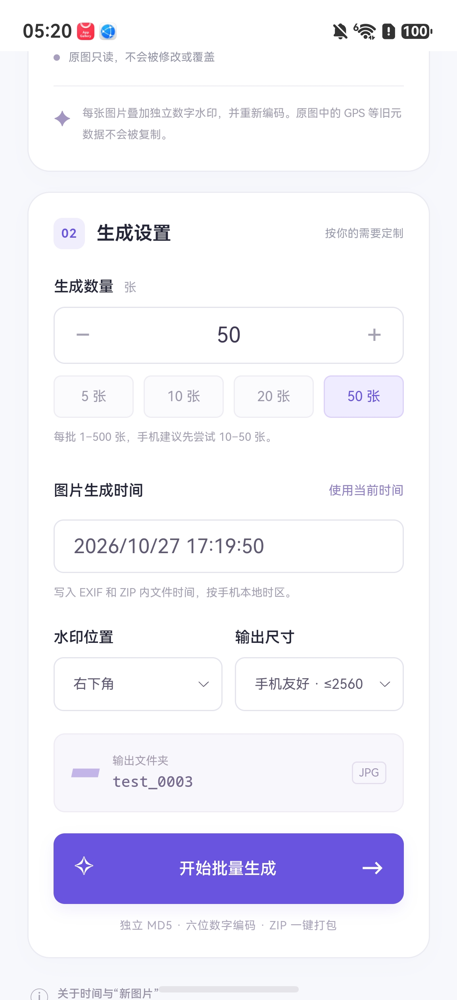

#### 数字水印位置

支持右下角、左下角、右上角和左上角四种位置，便于根据原图内容选择编号水印的放置区域。

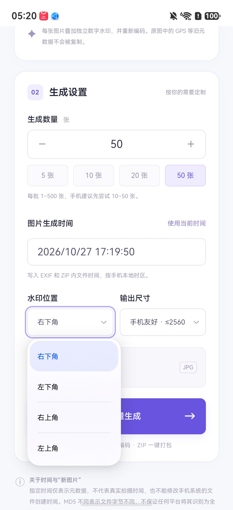

#### 输出尺寸

提供三种尺寸模式：手机友好（长边不超过 2560px）、轻量（长边不超过 2048px）、原始尺寸（最多 1600 万像素）。尺寸限制不会放大原图。

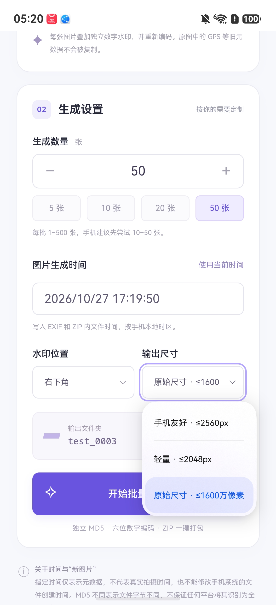

### 05 · 本地生成进度

开始生成后，界面展示当前处理状态、进度百分比、已生成数量和取消入口。处理过程中需保持页面在前台，避免锁屏或切换后台导致任务中断。

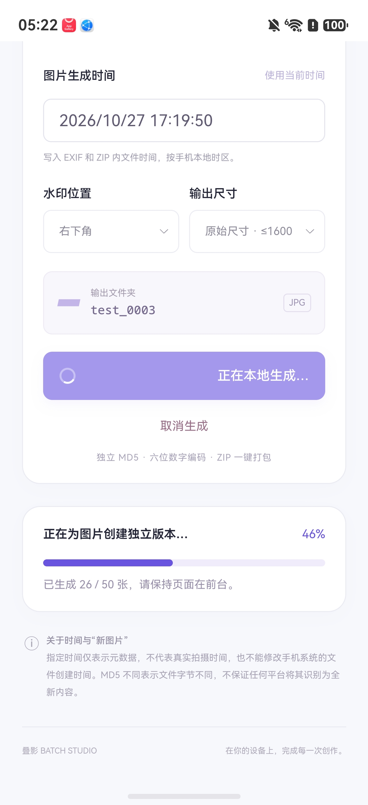

### 06 · 结果预览与 MD5 清单

#### 图片预览与单张保存

生成完成后，展示本批图片数量、批次文件夹、图片总大小和 MD5 校验状态。结果区提供编号图片缩略图、单张保存入口，以及整批 ZIP 下载入口。

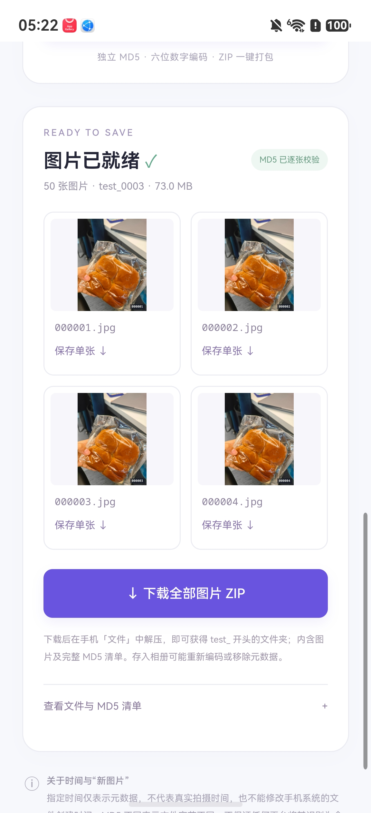

#### 文件与 MD5 对照

展开清单后，可查看输出文件名及对应 MD5，方便核对编号与文件差异。MD5 根据最终文件字节计算，仅用于差异标识，不保证平台将视觉内容判为新图片。

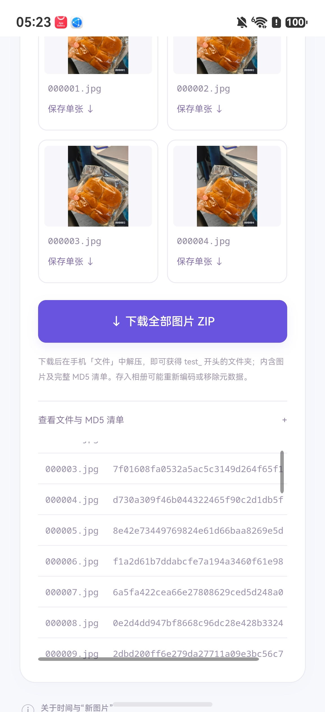

### 07 · ZIP 下载与文件管理

#### 确认下载

点击整批 ZIP 下载后，当前手机浏览器弹出下载确认框，展示压缩包名称和大小。下载弹窗的具体样式由系统与浏览器决定。

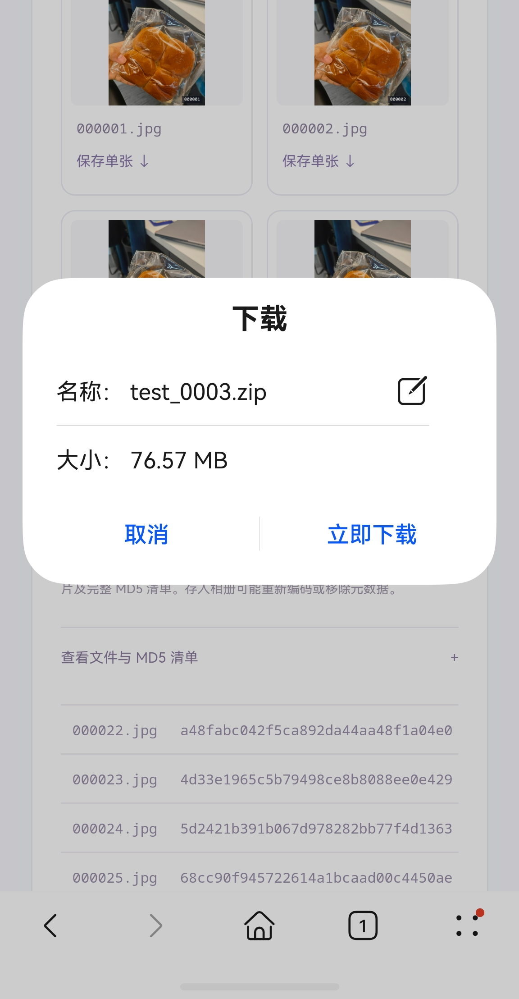

#### 在手机文件管理器中查找

下载后可在系统文件管理器的下载目录中查找 `test_0001.zip` 等批次压缩包，再解压查看图片及清单。实际保存路径和解压方式以目标手机为准；本图展示下载列表，不是解压后的文件夹。

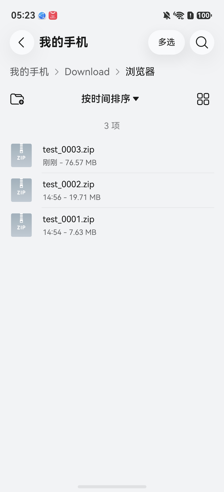
